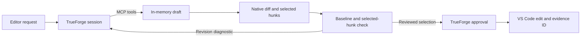

# OurLoss for VS Code

OurLoss is a coding agent for TrueFoundry Forge-a-thon Round 1. It lets developers **test the exact hunks they are about to accept**. The editor shows why files were retrieved, presents a native diff, and runs the same check against the baseline and the selected patch. A failed check can guide the next revision in the same TrueForge session.

[See the verified review in VS Code](docs/selected-hunks.jpg)

## Run it

Install VS Code 1.96 or later and Node 22.14 or later. Git is used for workspace indexing and the demo. Python is optional for syntax checks and required for the Flask demo.

1. Start TrueForge on loopback and register a model. [TrueForge setup](agent/README.md)
2. Open this project in VS Code and use the **Run OurLoss** launch profile. To install into your regular VS Code profile, [build the VSIX](#package-the-extension) first.
3. Open a trusted Git repository as a VS Code folder. Run **OurLoss: Open Agent** from the Command Palette, then use **Models** to enter the TrueForge provider/model alias.
4. Enter a repository request in the panel. For a selection edit, select text in the editor and press **Ctrl+Alt+I** on Windows/Linux or **Cmd+Alt+I** on macOS.
5. Review the diff, choose hunks, and click **Apply selected**. Use **Save reviewed files** to persist the editor changes. **Undo last change** reverts the last accepted batch when the edited buffers still match it. Save again to persist the undo.

The settings `ourloss.trueForgeUrl`, `ourloss.model`, `ourloss.fallbackModel`, `ourloss.contextBytes`, and `ourloss.python` control the harness connection, model aliases, retrieval budget, and syntax checker. Model credentials belong in TrueForge settings.

## Architecture

VS Code hosts the webview, workspace index and in-memory edits. TrueForge hosts the model conversation, streaming, MCP dispatch and approval. The editor advertises narrow search, read, draft, syntax-check and Git inspection tools. The model opens the `review_changes` approval after staging its draft. The editor binds the accepted hunk IDs to the immutable draft digest and reports their decision on the same TrueForge turn. The approved tool applies a single VS Code text edit batch. A rejected, cancelled or failed draft is discarded.



The automatic context packet ranks tracked and open text by the full request, balances implementation, test and documentation evidence, and displays excerpt ranges and ranking reasons. Budget accounting measures serialized UTF-8 bytes. Type explicit references as `@file:relative/path` or `@symbol:name`. Quote paths that contain spaces. The model can then narrow the evidence with MCP reads. TrueForge exposes the outline tool on demand and preloads frequently used tools.

The extension works with existing text files. Its Git tool supports status and diff statistics. Native diffs are read-only previews. Accepted changes live in buffers until saved under VS Code's save settings. Undo requires matching versions and files. A model error can start a fresh session with a configured fallback. Fallback drafts still require approval.

## Verify selected hunks before applying

Select hunks and click **Verify selected hunks**. The default check compares Python syntax in the baseline and the selected result. For a behavioral check, configure an executable, argument list and label in the user setting `ourloss.rehearsal`. The same command runs in two temporary copies of the tracked workspace, with dirty buffers included. One copy contains the baseline and the other contains the exact selected hunks. Review shows both results, output and the evidence fingerprint. Changing hunk selections clears the displayed result. Approval rechecks the fingerprint against the workspace when it uses a behavioral rehearsal receipt.

Use **Request revision** to send a failed diagnostic back through the native TrueForge approval. The model gets the reviewer’s reason and can propose another draft in the same session. If the user applies the verified selection, the approval tool result records its evidence ID and verdicts. Configure `evidenceFiles` with absolute paths for external verifier scripts or fixtures whose bytes should be included in the rehearsal fingerprint.

The rehearsal starts only from a review action and uses the configured command directly. It copies source and runs a process on the local machine. Use checks you trust, just as you would for normal local project tests. The temporary copies are limited to 5,000 tracked files and 32 MiB. Dependencies must already be available to the check process. The Flask demo supplies independent acceptance probes in `demo/rehearsal_checks.py`.

## Package the extension

```powershell
New-Item -ItemType Directory -Force output | Out-Null
npx --yes @vscode/vsce package --no-dependencies --no-rewrite-relative-links --out output/ourloss-0.1.0.vsix
code --install-extension ./output/ourloss-0.1.0.vsix
```

## Verify

```powershell
npm test
git clone --depth 1 --branch 3.1.3 https://github.com/pallets/flask.git demo/flask
uv sync --project demo/flask --python 3.11 --no-default-groups --group tests --frozen
$env:OURLOSS_FLASK_CHECKOUT = (Resolve-Path demo/flask).Path
npm test
```

The fixed task prompts and baseline commit are in [demo/tasks.json](demo/tasks.json). The development-host driver starts a separate Flask copy for each task. With VS Code installed in its standard Windows location, run `node test/host/run.js A provider/model` or `node test/host/run.js B provider/model`. Use `node test/host/run.js C` after configuring the deliberately unreachable provider for Task C. Each host run records the TrueForge session and the observed editor and Git results. [Agent and model setup](agent/README.md)

Run `node test/host/run.js E provider/model` for editor edge cases and `node test/host/run.js X provider/model` for an inert workspace-instruction fixture. The injection check tracks the model’s actual activity separately from direct tests of the path, credential and command boundaries. [Development-host guide](test/host/README.md)

The project was built from scratch for Team OurLoss. It uses the TrueForge harness and Microsoft VS Code APIs. The competition fixture is Pallets' Flask 3.1.3 under its upstream license. Codex helped research, implement and test the extension.
